# Design gallery

What DebCraft starts from when it designs a page or an application screen. Generated by `scripts/dev/make_design_gallery.py` from the asset catalogue; the pictures are real renderings in Edge
(desktop 1280 px, phone 375 px). Nothing here is shipped as it is: the model replaces the tokens, the words and the numbers.

## Page compositions (marketing pages) (7)

Seven complete layouts with drawn art; a candidate design names one as `composition: lay-...`.

### `lay-editorial-split`: Editorial split

A large serif headline with a small-caps dateline, thin rules and a tall arch of drawn landscape art.

*moods: warm, calm, editorial; density: balanced; for: care, culture, education, boutique, libraries*

[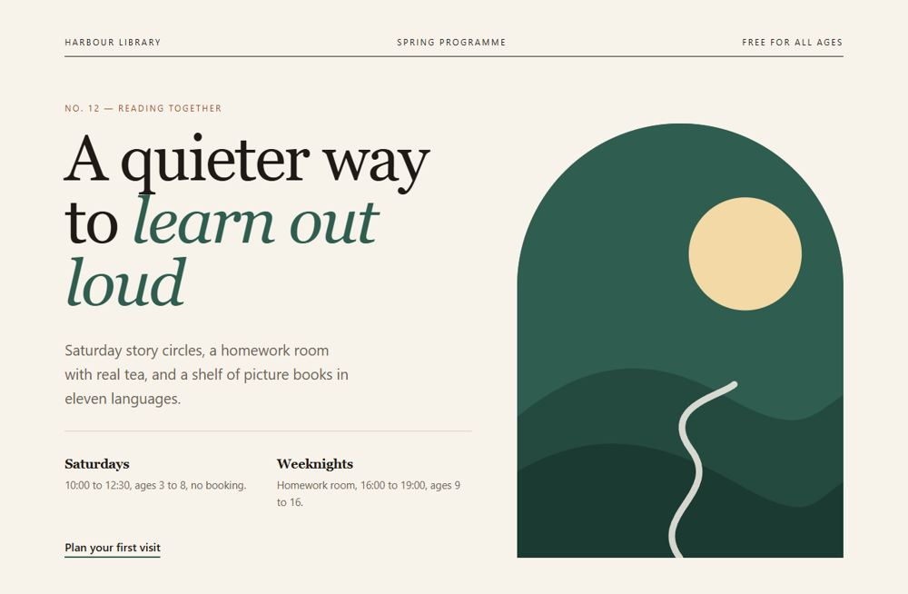](../src/forge/skills/ui-design-quality/assets/preview/lay-editorial-split-desktop.jpg) [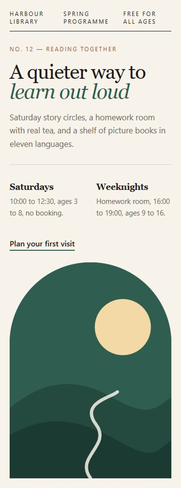](../src/forge/skills/ui-design-quality/assets/preview/lay-editorial-split-phone.jpg)

### `lay-fullbleed-blocks`: Full-bleed colour blocks

Sections as edge-to-edge colour bands with huge numbers and off-centre text, so the page has rhythm.

*moods: confident, modern, bold; density: balanced; for: studios, agencies, product stories, reports*

[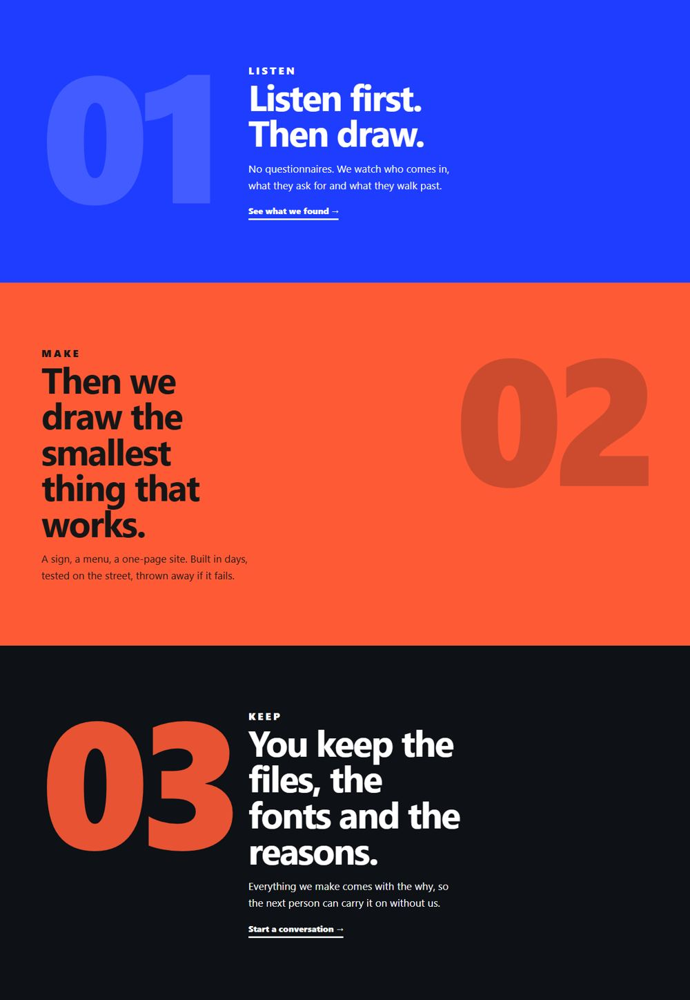](../src/forge/skills/ui-design-quality/assets/preview/lay-fullbleed-blocks-desktop.jpg) [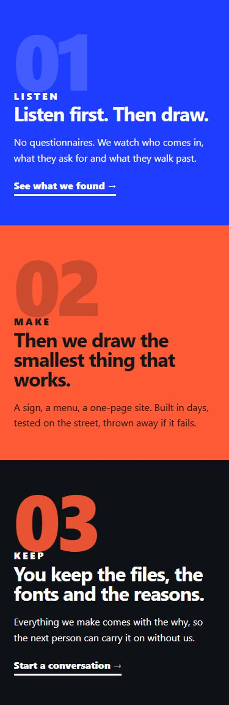](../src/forge/skills/ui-design-quality/assets/preview/lay-fullbleed-blocks-phone.jpg)

### `lay-menu-list`: Menu with leaders

A printed-menu layout: numbered dishes, dotted leaders to the price, two columns, a ruled heading and a drawn bowl.

*moods: warm, refined, dark; density: balanced; for: restaurants, cafes, bars, price lists*

[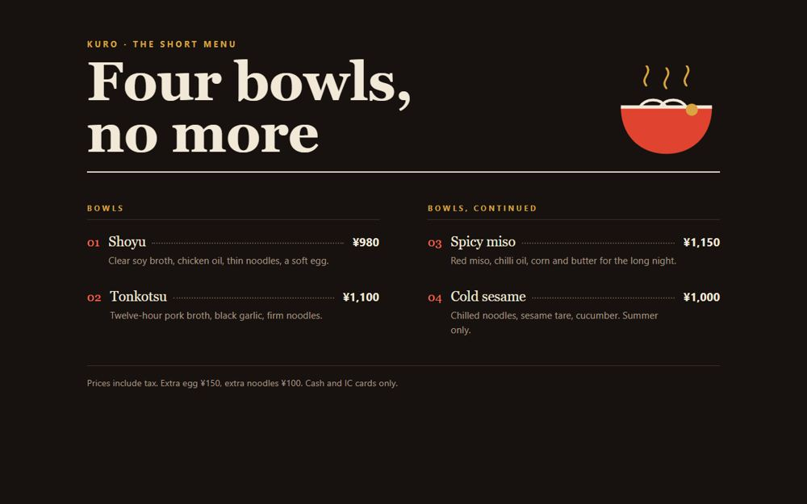](../src/forge/skills/ui-design-quality/assets/preview/lay-menu-list-desktop.jpg) [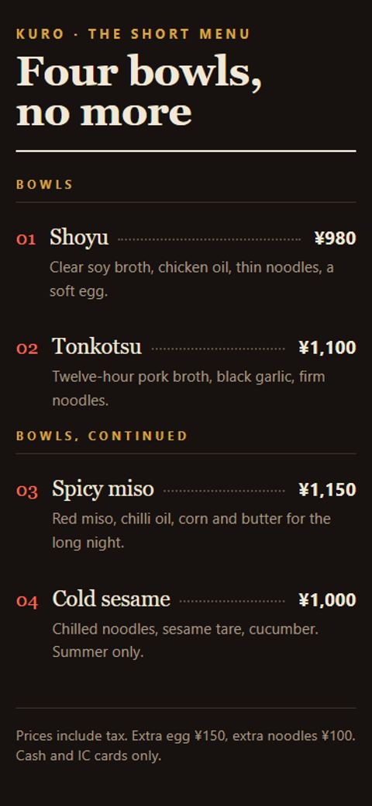](../src/forge/skills/ui-design-quality/assets/preview/lay-menu-list-phone.jpg)

### `lay-notebook-grid`: Lab notebook

Graph paper, a handwritten headline with a highlighter mark, taped experiment cards and a dashed arrow.

*moods: playful, curious, handmade; density: balanced; for: science, kids, maker spaces, workshops, tutorials*

[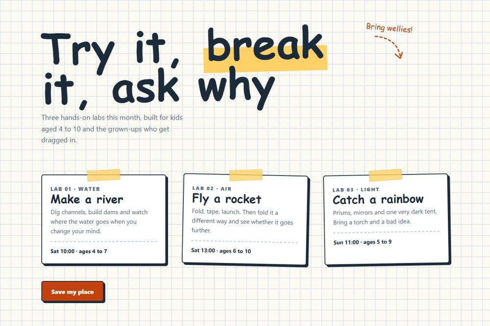](../src/forge/skills/ui-design-quality/assets/preview/lay-notebook-grid-desktop.jpg) [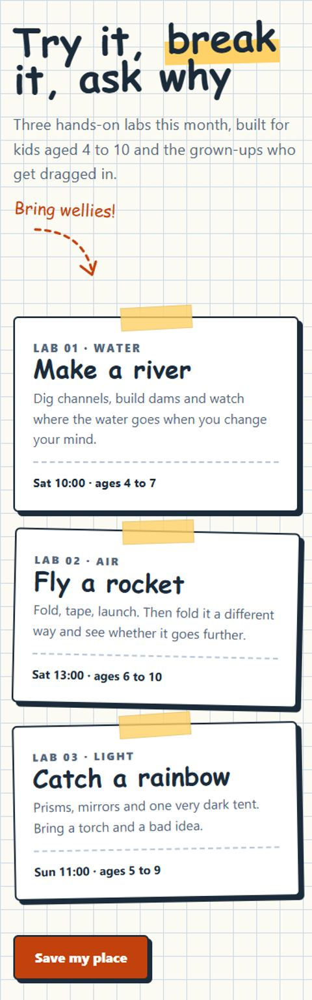](../src/forge/skills/ui-design-quality/assets/preview/lay-notebook-grid-phone.jpg)

### `lay-poster-hero`: Poster hero

A headline that fills the width in heavy uppercase type, a hard-shadow action, a rotated sticker, a marquee strip and a drawn sun.

*moods: bold, urgent, loud; density: balanced; for: events, nightlife, launches, sport*

[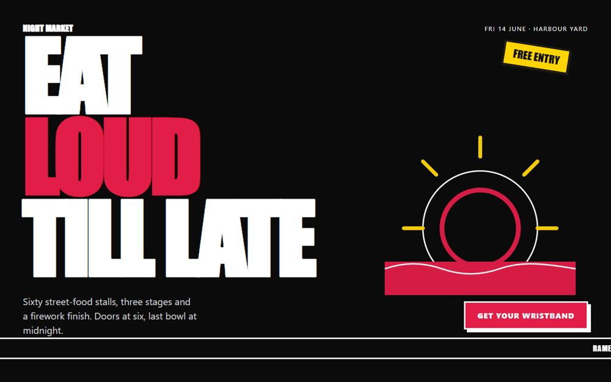](../src/forge/skills/ui-design-quality/assets/preview/lay-poster-hero-desktop.jpg) [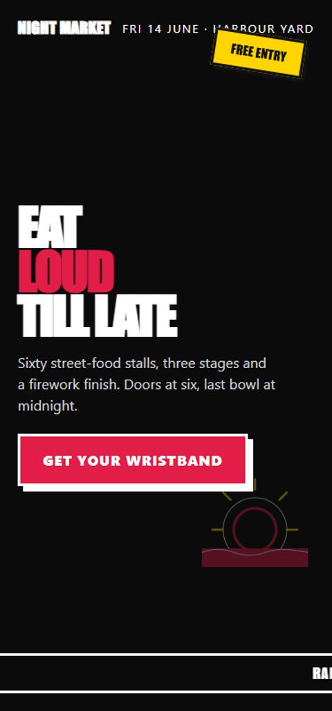](../src/forge/skills/ui-design-quality/assets/preview/lay-poster-hero-phone.jpg)

### `lay-ticket-stub`: Ticket stubs

Prices or plans as paper tickets with a perforated tear line and notched edges, slightly rotated.

*moods: playful, warm, friendly; density: balanced; for: museums, events, cinemas, entry prices*

[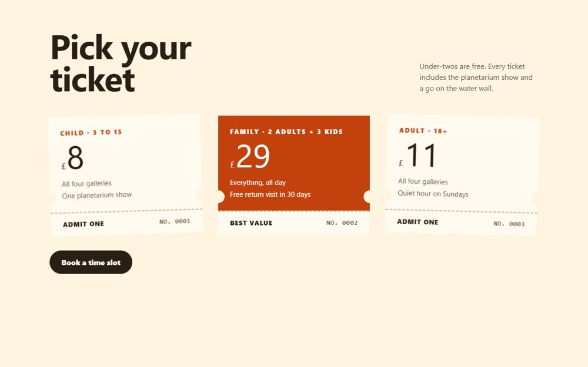](../src/forge/skills/ui-design-quality/assets/preview/lay-ticket-stub-desktop.jpg) [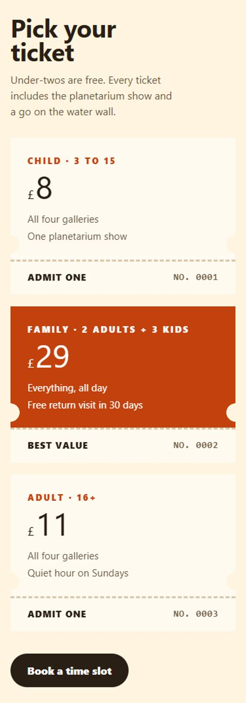](../src/forge/skills/ui-design-quality/assets/preview/lay-ticket-stub-phone.jpg)

### `lay-vertical-type`: Vertical type sign

An oversized vertical word like a shop sign beside a quiet text block and a drawn paper lantern; set for Japanese or East Asian type.

*moods: dramatic, night, craft; density: balanced; for: late-night food, japanese brands, bars, craft*

[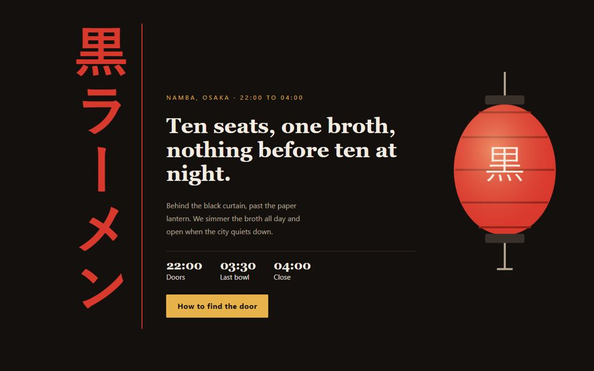](../src/forge/skills/ui-design-quality/assets/preview/lay-vertical-type-desktop.jpg) [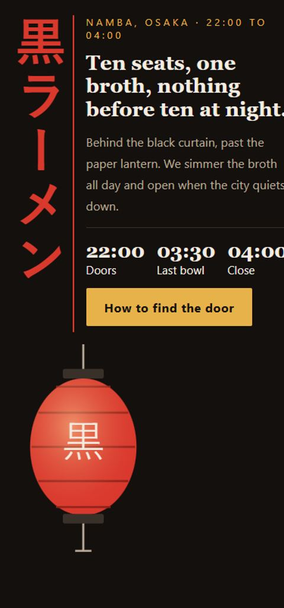](../src/forge/skills/ui-design-quality/assets/preview/lay-vertical-type-phone.jpg)

## Application screens, plain HTML (24)

Twenty-four dashboards, tables, forms, settings and web-app screens; `composition: app-...`. The React versions (`app-react-*`) are the same screens.

### `app-calendar`: Calendar: week view

A week calendar: a mini month and calendar toggles on the side, a time grid with positioned, colour-coded events, today's column marked and a Day, Week, Month switch.

*moods: organised, calm, light; density: balanced; for: scheduling, booking, planning, team calendar, appointments*

[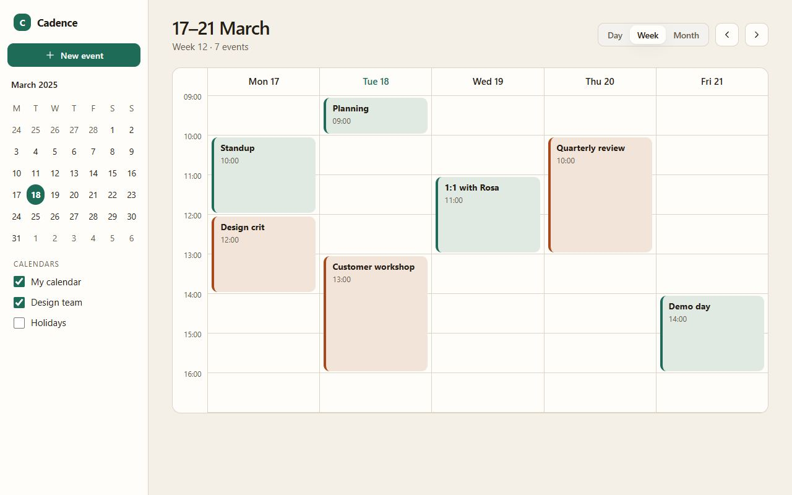](../src/forge/skills/ui-design-quality/assets/preview/app-calendar-desktop.jpg) [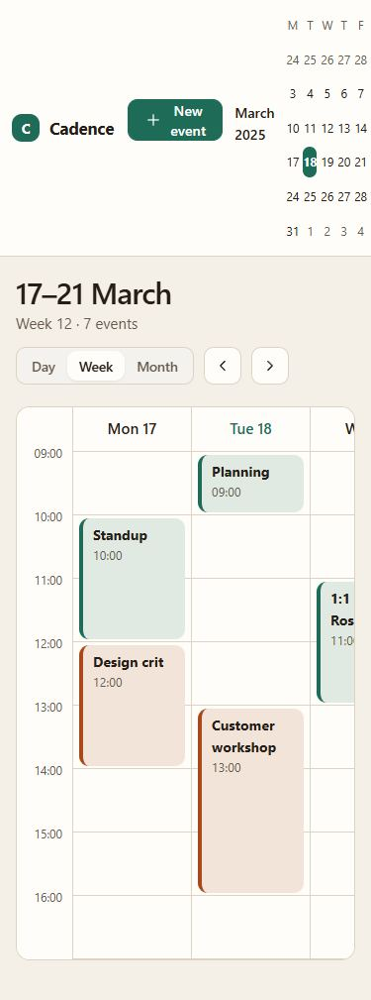](../src/forge/skills/ui-design-quality/assets/preview/app-calendar-phone.jpg)

### `app-chat`: Chat: conversations and thread

A team chat: a conversation list with previews and times, a thread with grouped bubbles, a day marker and your own messages in the accent, and a composer pinned to the bottom.

*moods: quick, informal, dark; density: balanced; for: messaging, collaboration, community, support chat, assistant*

[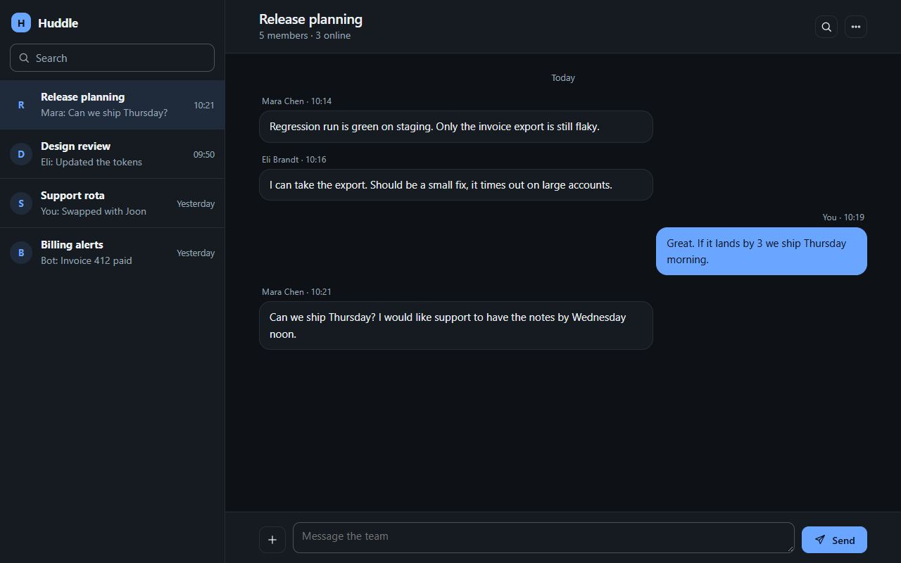](../src/forge/skills/ui-design-quality/assets/preview/app-chat-desktop.jpg) [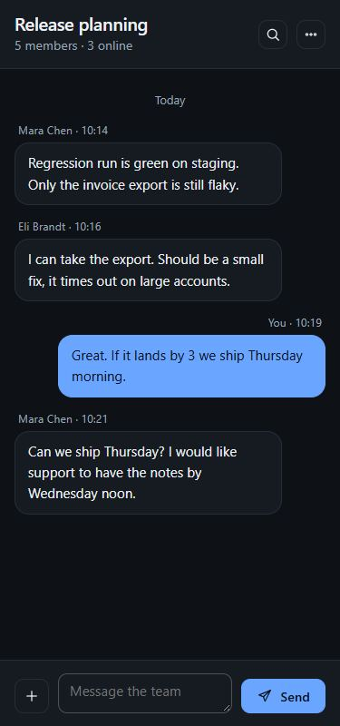](../src/forge/skills/ui-design-quality/assets/preview/app-chat-phone.jpg)

### `app-dashboard-analytics`: Dashboard: analytics (dark)

A dark analytics screen: range selector, three metrics with sparklines, a two-line chart, a top-pages table with trends and a funnel.

*moods: technical, focused, dark; density: dense; for: analytics, growth, developer tools, saas, marketing*

[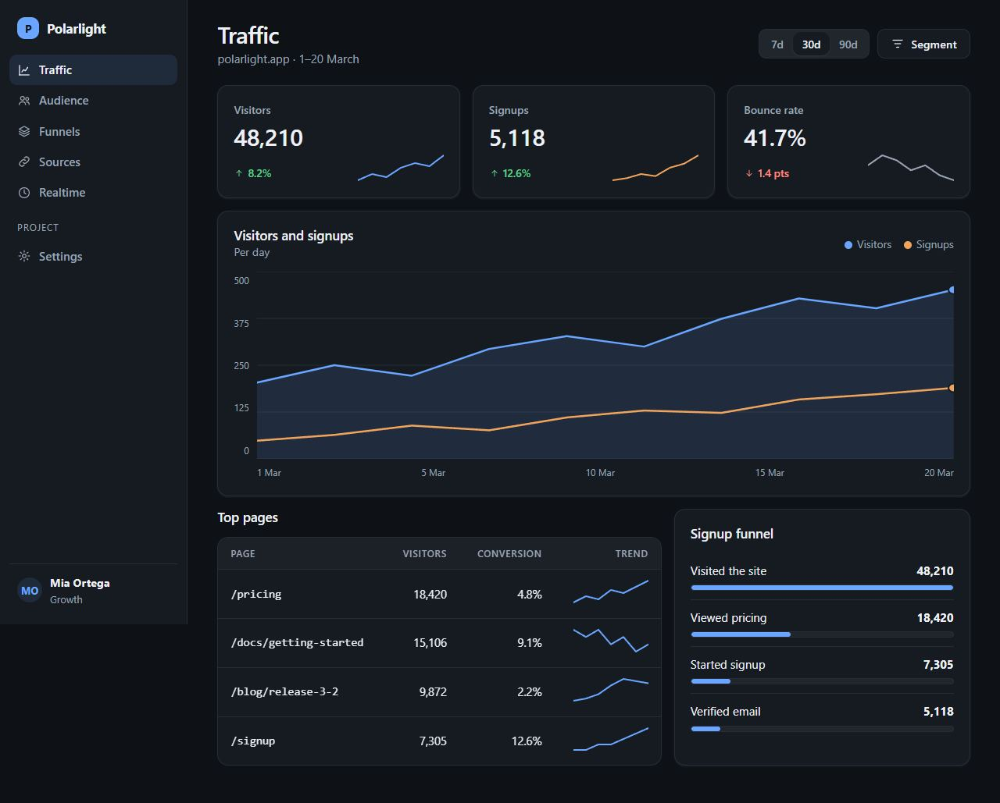](../src/forge/skills/ui-design-quality/assets/preview/app-dashboard-analytics-desktop.jpg) [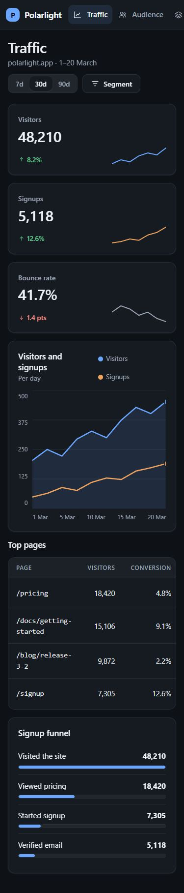](../src/forge/skills/ui-design-quality/assets/preview/app-dashboard-analytics-phone.jpg)

### `app-dashboard-kpi`: Dashboard: sales KPIs

A side-navigation finance dashboard: four KPI cards with deltas, a two-series revenue chart, a channel ring and a recent-orders table.

*moods: calm, professional, light; density: balanced; for: finance, sales, e-commerce, saas, admin*

[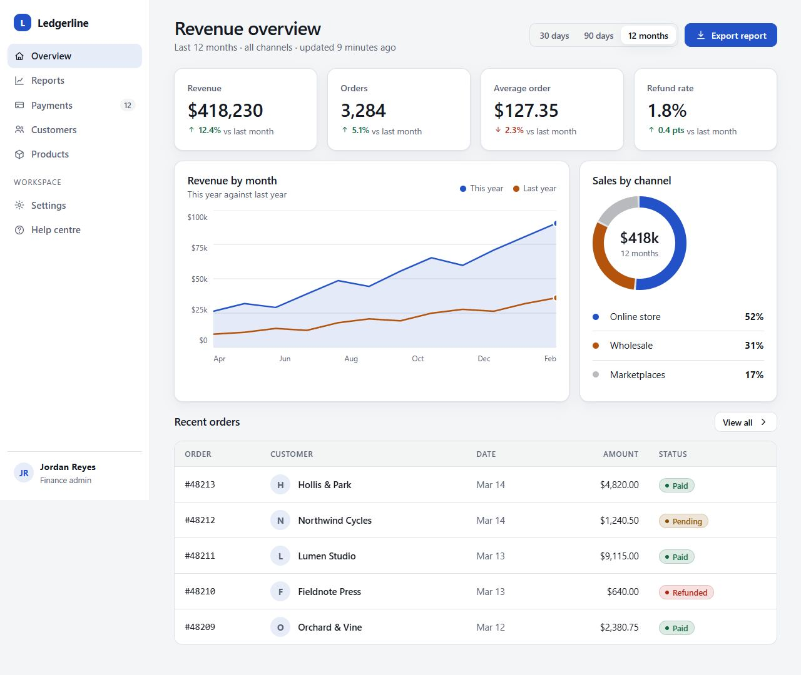](../src/forge/skills/ui-design-quality/assets/preview/app-dashboard-kpi-desktop.jpg) [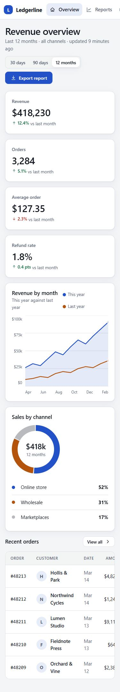](../src/forge/skills/ui-design-quality/assets/preview/app-dashboard-kpi-phone.jpg)

### `app-dashboard-ops`: Dashboard: operations board

A top-navigation operations board: status counters, a shipments table with progress meters, on-time bars and an exceptions list.

*moods: practical, calm, teal; density: balanced; for: logistics, operations, fleet, support, field service*

[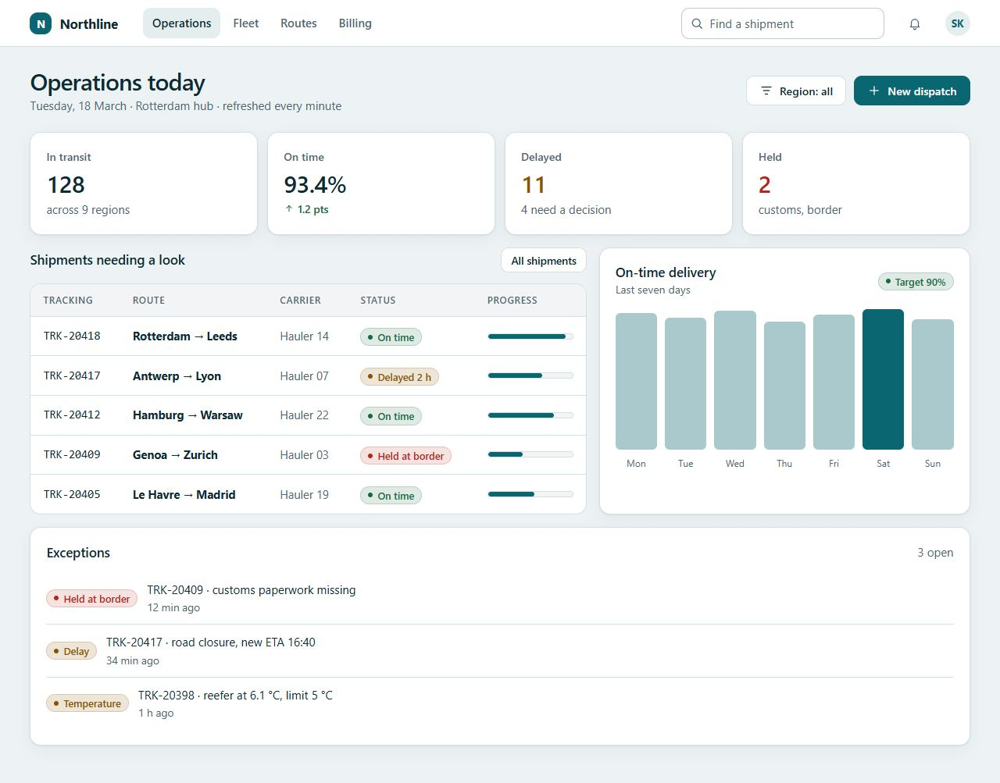](../src/forge/skills/ui-design-quality/assets/preview/app-dashboard-ops-desktop.jpg) [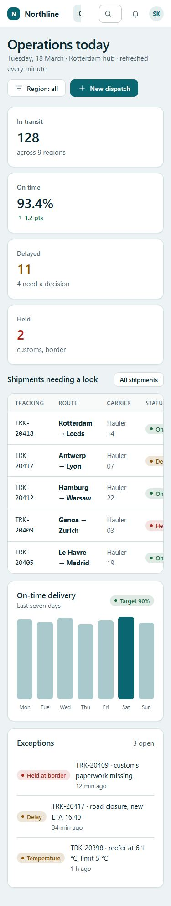](../src/forge/skills/ui-design-quality/assets/preview/app-dashboard-ops-phone.jpg)

### `app-dashboard-personal`: Dashboard: personal day view

A friendly personal overview: a greeting, today's schedule, progress rings for weekly goals and a focus-time chart.

*moods: warm, friendly, light; density: airy; for: productivity, personal, wellbeing, education, customer success*

[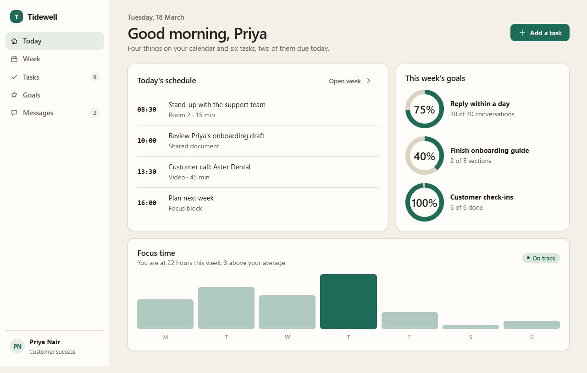](../src/forge/skills/ui-design-quality/assets/preview/app-dashboard-personal-desktop.jpg) [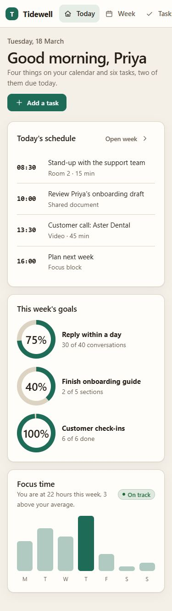](../src/forge/skills/ui-design-quality/assets/preview/app-dashboard-personal-phone.jpg)

### `app-editor`: Editor: document with outline and comments

A writing surface: a page tree and an on-this-page outline, a formatting bar, a large editable title, checklist items, and a comments column with open threads.

*moods: quiet, focused, light; density: airy; for: documents, wiki, notes, knowledge base, handbook*

[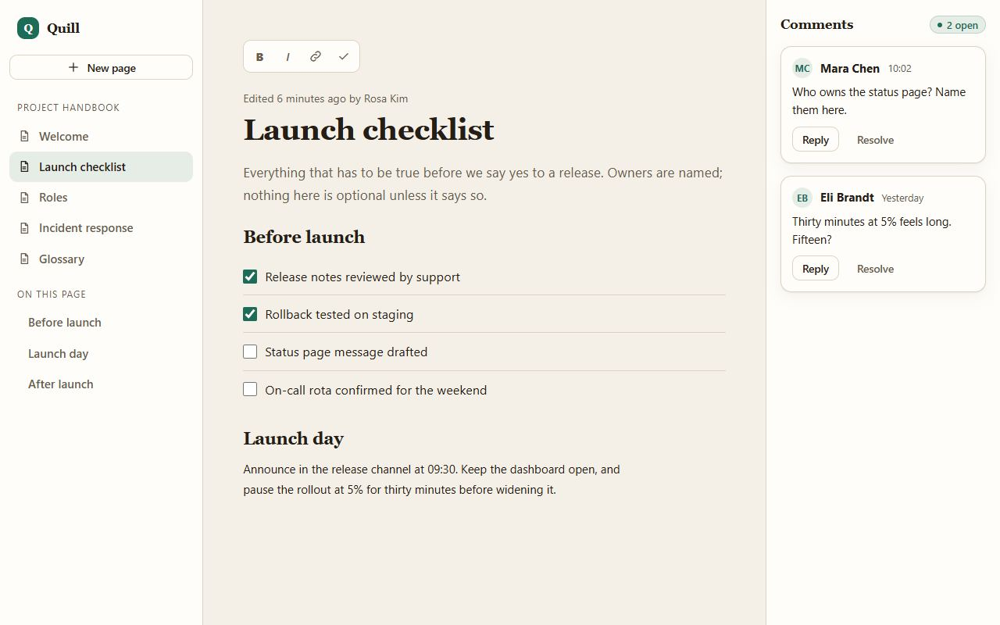](../src/forge/skills/ui-design-quality/assets/preview/app-editor-desktop.jpg) [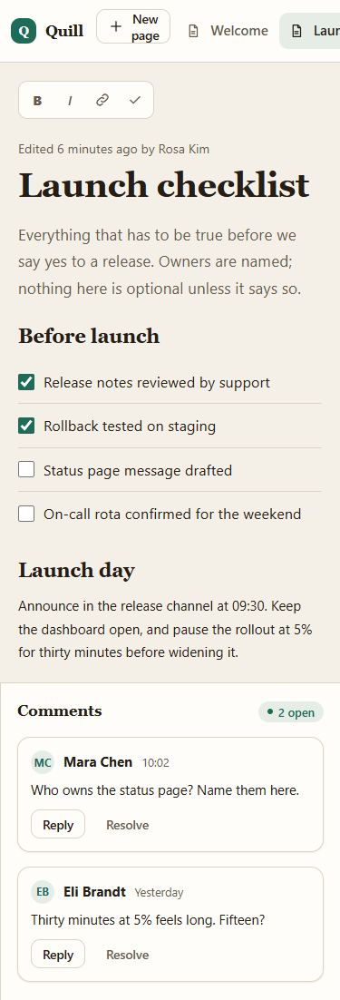](../src/forge/skills/ui-design-quality/assets/preview/app-editor-phone.jpg)

### `app-empty-states`: States: empty, no results, error, offline, loading and first run

Six state cards (empty list, no search results, load error, offline, skeleton loading, all caught up) and a first-run checklist with progress, so every moment without data has a next step.

*moods: helpful, plain, light; density: airy; for: any app, saas, onboarding, error handling*

[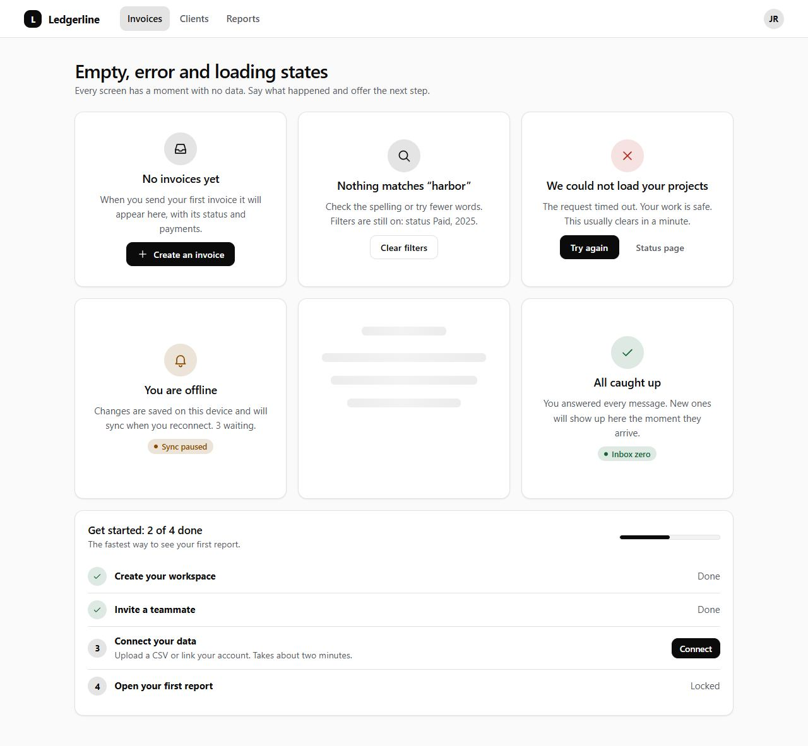](../src/forge/skills/ui-design-quality/assets/preview/app-empty-states-desktop.jpg) [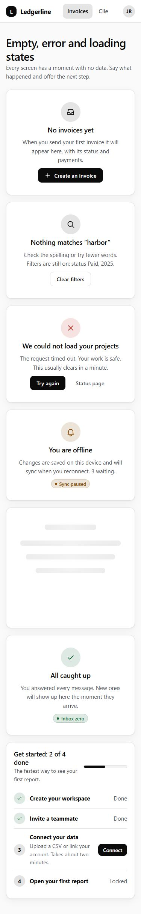](../src/forge/skills/ui-design-quality/assets/preview/app-empty-states-phone.jpg)

### `app-form-line-entry`: Form: invoice with line items

A document-style data entry screen: header fields, an editable lines table with live amounts, notes and a totals block, with save, preview and send actions.

*moods: businesslike, efficient, light; density: balanced; for: invoicing, quotes, orders, expenses, timesheets*

[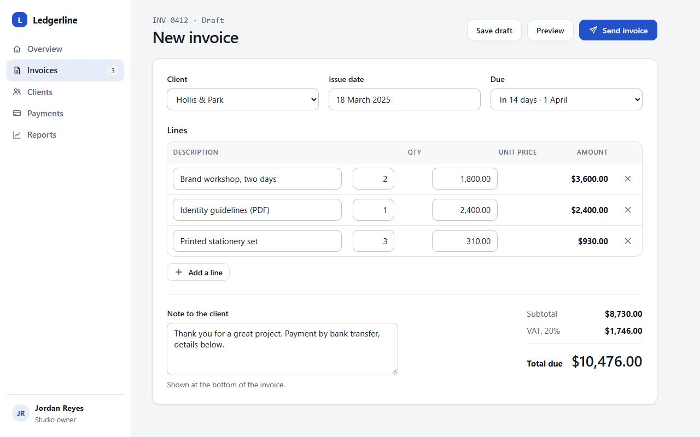](../src/forge/skills/ui-design-quality/assets/preview/app-form-line-entry-desktop.jpg) [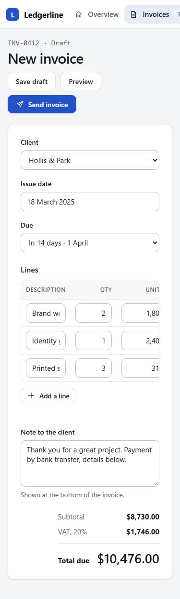](../src/forge/skills/ui-design-quality/assets/preview/app-form-line-entry-phone.jpg)

### `app-form-long`: Form: long page form with validation

A long single-page form in titled sections (the heading and help on the left, the fields on the right), an error summary that links to each field, inline errors and a sticky action bar.

*moods: clear, trustworthy, light; density: airy; for: healthcare, registration, applications, hr, government*

[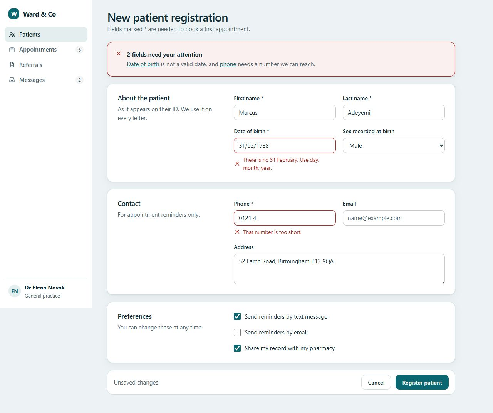](../src/forge/skills/ui-design-quality/assets/preview/app-form-long-desktop.jpg) [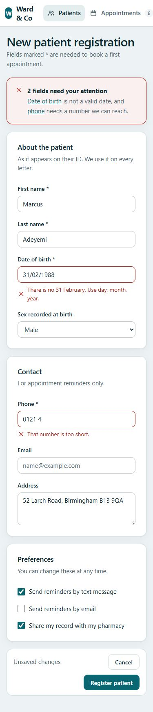](../src/forge/skills/ui-design-quality/assets/preview/app-form-long-phone.jpg)

### `app-form-quick-capture`: Form: quick capture

A fast entry form for frequent small records: one big text box, category chips, two short fields, a keyboard hint, and today's earlier entries beside it.

*moods: friendly, quick, light; density: balanced; for: field work, logs, hospitality, operations, notes*

[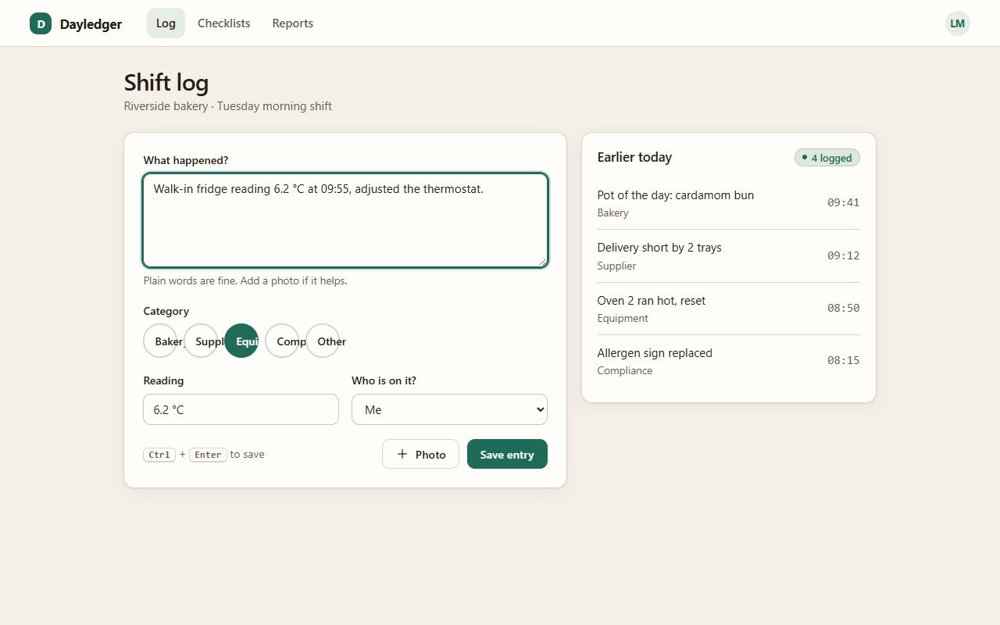](../src/forge/skills/ui-design-quality/assets/preview/app-form-quick-capture-desktop.jpg) [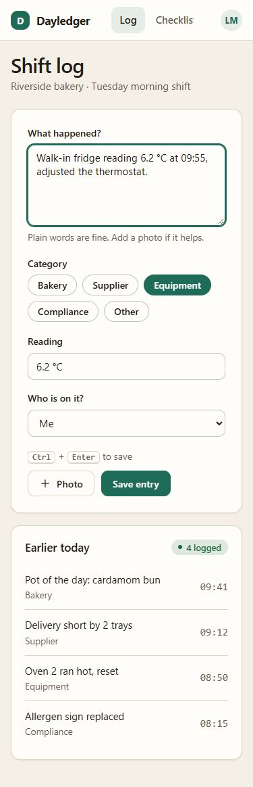](../src/forge/skills/ui-design-quality/assets/preview/app-form-quick-capture-phone.jpg)

### `app-form-sign-in`: Form: sign-in split screen

A sign-in page split in two: the form (single sign-on, email, password, remember me) beside a colour panel with drawn contour art and a customer quote.

*moods: welcoming, confident, teal; density: airy; for: authentication, saas, marketplace, booking, portal*

[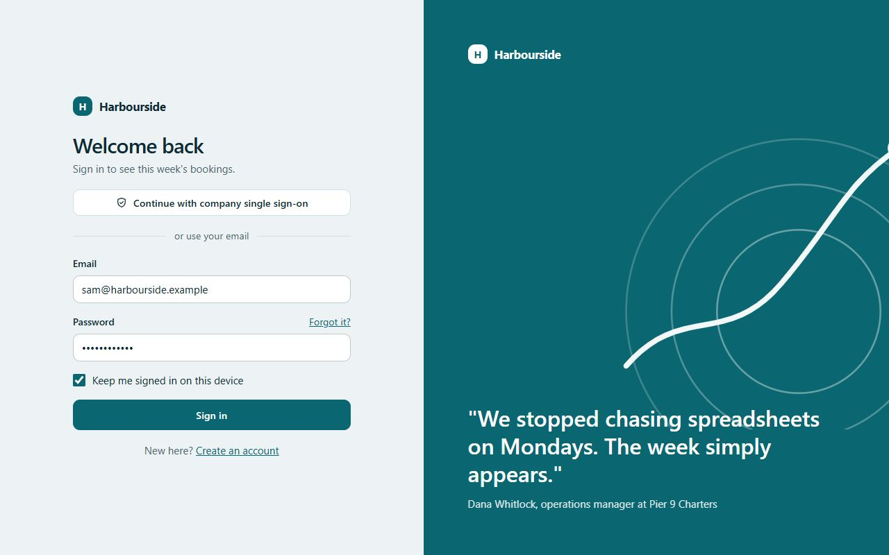](../src/forge/skills/ui-design-quality/assets/preview/app-form-sign-in-desktop.jpg) [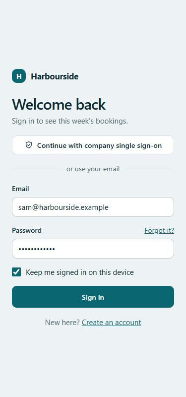](../src/forge/skills/ui-design-quality/assets/preview/app-form-sign-in-phone.jpg)

### `app-form-wizard`: Form: multi-step wizard

A stepper with done, current and next steps, a card of billing fields with a visible error, plan choice cards, and an order summary beside it.

*moods: calm, guided, light; density: airy; for: onboarding, checkout, registration, applications, setup*

[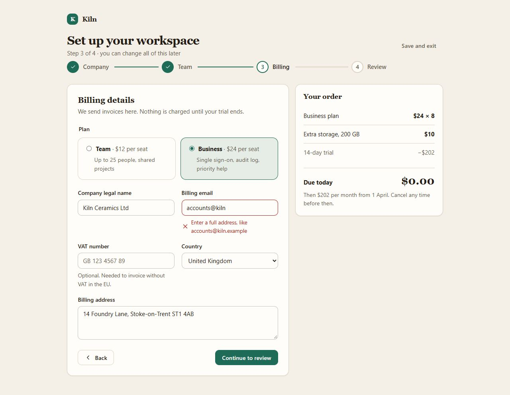](../src/forge/skills/ui-design-quality/assets/preview/app-form-wizard-desktop.jpg) [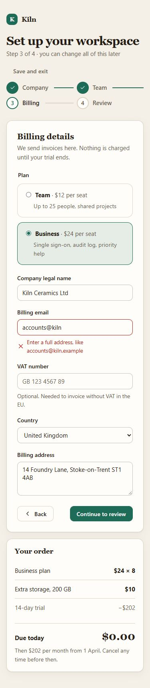](../src/forge/skills/ui-design-quality/assets/preview/app-form-wizard-phone.jpg)

### `app-inbox`: Inbox: three panes

A mail-style inbox: folders and labels, a message list with unread emphasis and a selected row, and the open message with actions and an inline reply.

*moods: productive, familiar, light; density: balanced; for: email, support, messaging, tickets, case management*

[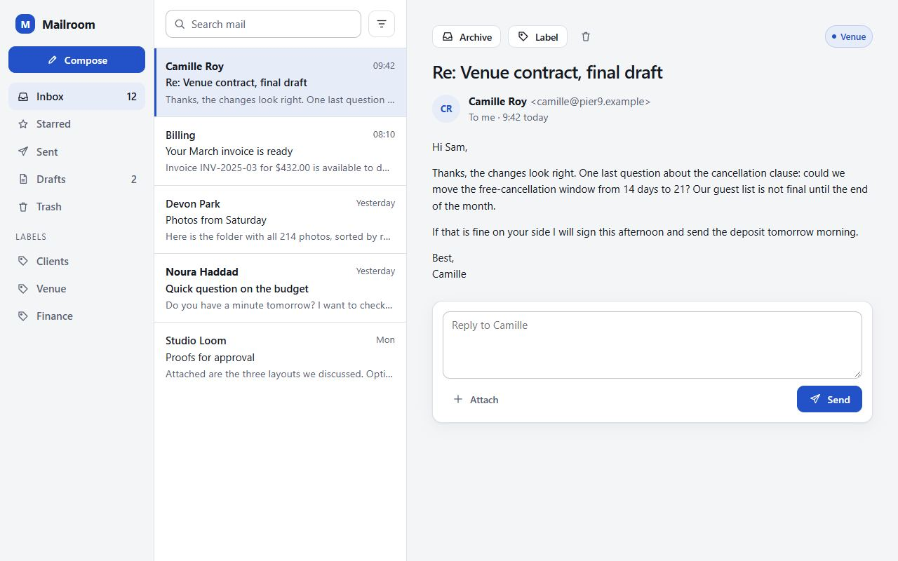](../src/forge/skills/ui-design-quality/assets/preview/app-inbox-desktop.jpg) [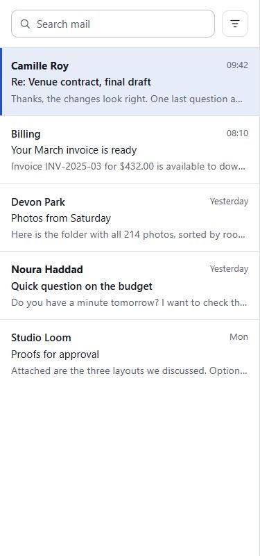](../src/forge/skills/ui-design-quality/assets/preview/app-inbox-phone.jpg)

### `app-map-list`: Map: list and map side by side

A locator: a result list with status pills beside a drawn map with numbered pins, zoom controls and a detail card for the selected place.

*moods: clear, practical, light; density: balanced; for: logistics, store locator, delivery, real estate, field service*

[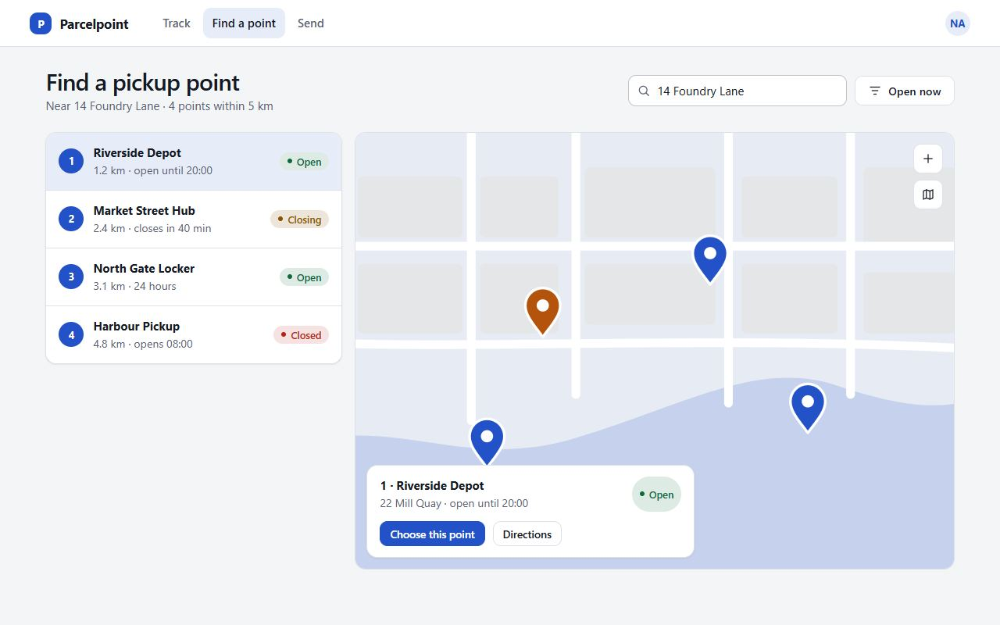](../src/forge/skills/ui-design-quality/assets/preview/app-map-list-desktop.jpg) [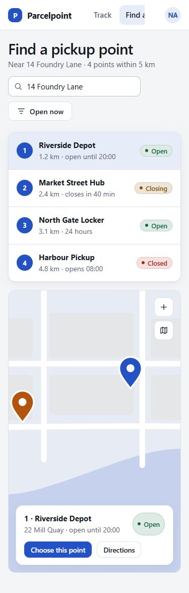](../src/forge/skills/ui-design-quality/assets/preview/app-map-list-phone.jpg)

### `app-record`: Record: customer profile

A record page: identity header with status pills and actions, tabs, an activity timeline with a note box, and a side card of key details and account health.

*moods: considered, calm, light; density: balanced; for: crm, customers, patients, accounts, candidates*

[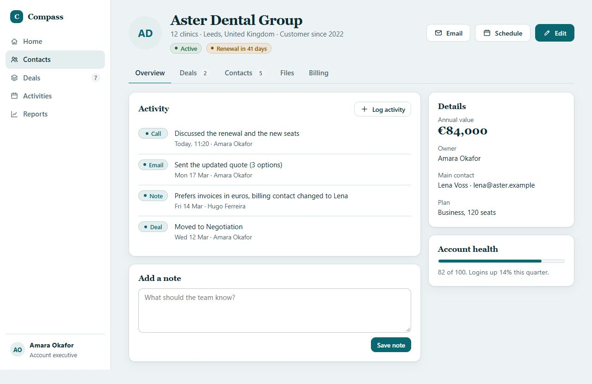](../src/forge/skills/ui-design-quality/assets/preview/app-record-desktop.jpg) [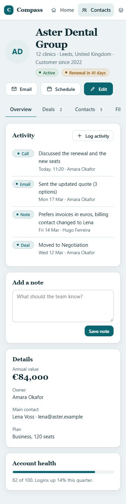](../src/forge/skills/ui-design-quality/assets/preview/app-record-phone.jpg)

### `app-settings-account`: Settings: account, security and API keys

A settings page with a vertical section menu, a profile form, toggle rows, an API key list with copy and revoke, and a separated danger zone.

*moods: clear, calm, light; density: balanced; for: developer tools, saas, admin, account*

[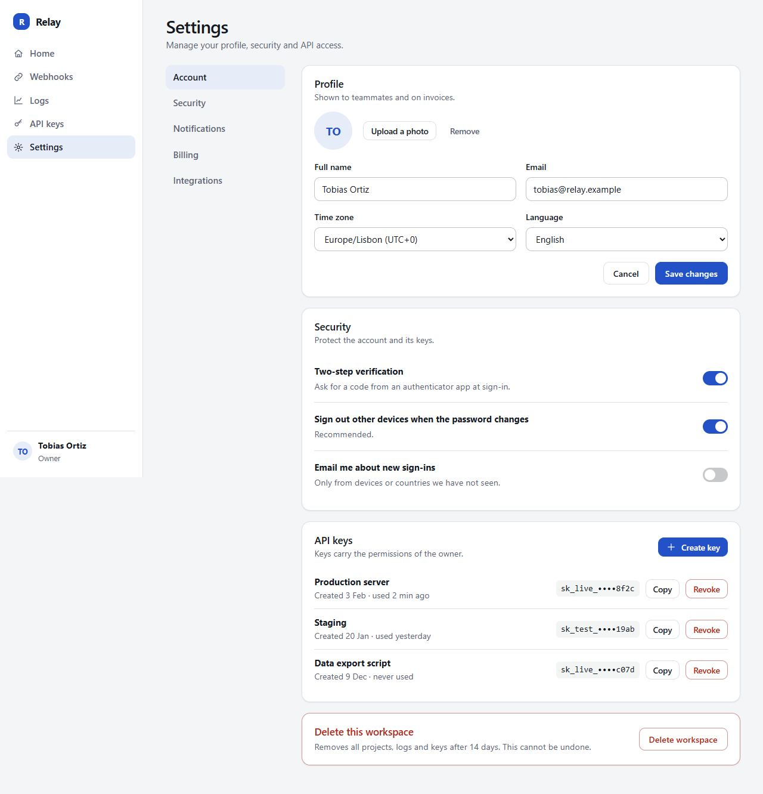](../src/forge/skills/ui-design-quality/assets/preview/app-settings-account-desktop.jpg) [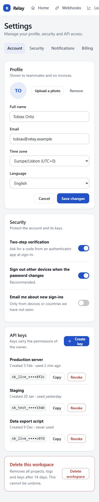](../src/forge/skills/ui-design-quality/assets/preview/app-settings-account-phone.jpg)

### `app-settings-billing`: Settings: plan, usage and invoices

A billing page with the current plan, usage meters against limits, a payment method card, a billing contact and an invoice table.

*moods: trustworthy, plain, light; density: balanced; for: saas, subscriptions, billing, membership*

[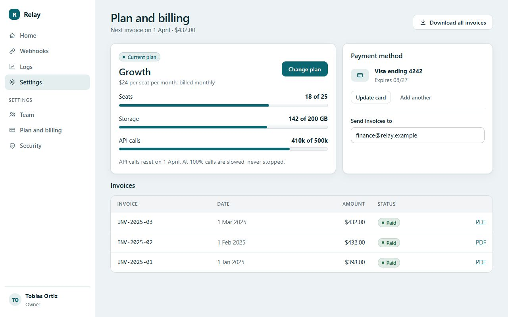](../src/forge/skills/ui-design-quality/assets/preview/app-settings-billing-desktop.jpg) [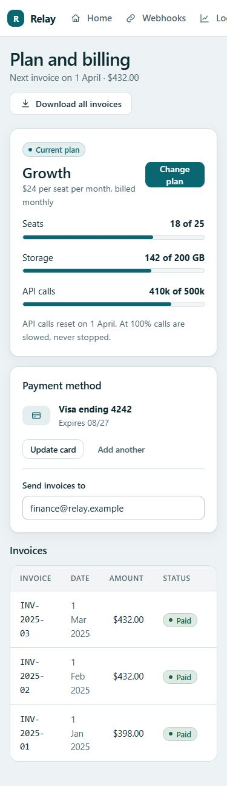](../src/forge/skills/ui-design-quality/assets/preview/app-settings-billing-phone.jpg)

### `app-settings-notifications`: Settings: notification preferences

A preference matrix of events against channels with switches, plus quiet hours with time fields and a digest schedule.

*moods: calm, considerate, light; density: airy; for: productivity, communication, collaboration, mobile app*

 

### `app-settings-roles`: Settings: roles and permissions grid

A permission matrix of rights against roles with checkboxes (the owner column fixed), beside a member list where each person's role is a select.

*moods: technical, precise, dark; density: dense; for: admin, security, enterprise, developer tools*

 

### `app-table-data`: Table: people with filters and bulk actions

A full data table: search, status segments, a bulk-action bar for selected rows, avatars, status pills, row actions and pagination.

*moods: precise, plain, light; density: balanced; for: admin, team management, saas, hr, back office*

 

### `app-table-editable-grid`: Table: editable grid for fast entry

A grid whose number cells are inputs: scan or type a SKU, tab through counts, low-stock status, and a sticky save bar that says how many cells changed.

*moods: practical, fast, light; density: dense; for: inventory, warehouse, data entry, spreadsheet, back office*

 

### `app-table-kanban`: Board: kanban lanes

A kanban board with four lanes, labelled cards with due dates and assignees, lane counts and add-card buttons; the lanes scroll sideways inside their frame on a phone.

*moods: warm, organised, light; density: balanced; for: project management, tasks, workflow, recruiting, support*

 

### `app-table-master-detail`: Table: master and detail

A list on the left and the selected record on the right: header, tabs, key figures, line items, activity and decision buttons.

*moods: businesslike, calm, light; density: balanced; for: procurement, approvals, support, crm, orders*

 

## Design systems (tokenised starting points) (14)

Fourteen DESIGN.md starting points with a specimen picture each.

### `ds-bento`: Bento and cards

An unequal grid of rounded tiles, each holding one idea, in neutral tones with two tinted accents.

*moods: modern, organised, light; density: balanced; for: feature overviews, personal sites, dashboard home*

### `ds-bold-poster`: Bold campaign poster

Near-black, one hot colour, huge grotesk type and hard offset shadows: loud and urgent.

*moods: bold, urgent, loud; density: balanced; for: events, drives, launches, sport*

### `ds-claymorphism`: Claymorphism

Pastel fills, chunky radii and soft inner shadows that make everything look moulded: gentle and tactile.

*moods: soft, tactile, gentle; density: airy; for: onboarding, games, kids products*

### `ds-clean-product`: Clean product

White and pale blue-grey, one saturated accent, navy text, layered soft shadows: confident B2B.

*moods: clean, confident, precise; density: balanced; for: b2b, fintech, dashboards, saas*

### `ds-dark-dashboard`: Dark dashboard

Near-black surfaces, light text, one indigo accent and clear status colours: dense and calm.

*moods: dark, dense, technical, calm; density: dense; for: analytics, ops, monitoring, admin*

### `ds-glass-aurora`: Glass and aurora

A dark base, frosted glass panels and a sparing indigo-to-cyan glow: modern AI and developer tools.

*moods: dark, modern, glowing; density: balanced; for: saas, ai, developer tools*

### `ds-minimal-monochrome`: Minimal monochrome

Black, white, one grey and one accent used once per screen; large type and huge margins.

*moods: minimal, refined, quiet; density: airy; for: portfolio, architecture, luxury*

### `ds-neo-brutalist`: Neo-brutalist

Flat saturated colours on cream with thick black outlines and hard shadows: playful and honest.

*moods: playful, raw, honest; density: balanced; for: creative tools, indie products, playful brands*

### `ds-playful-friendly`: Playful and friendly

Bright, rounded and bouncy: big radii, thick-stroke icons and a rounded sans.

*moods: playful, friendly, bright; density: balanced; for: kids, food, community, consumer apps*

### `ds-retro-terminal`: Retro terminal

Monospace type, 1px borders and phosphor green on black: for developer tools and nostalgia.

*moods: retro, technical, nostalgic; density: balanced; for: developer tools, games*

### `ds-soft-editorial`: Soft editorial

Warm off-white, a serif display, generous whitespace and soft shadows: humane and trustworthy.

*moods: warm, calm, trustworthy, editorial; density: airy; for: health, charity, education, boutique*

### `ds-tpl-charity`: Charity and community (template palette)

The palette and type of the charity landing template: warm paper, ink and one brave red.

*moods: warm, editorial, trustworthy; density: balanced; for: charity, health, community, events, education*

### `ds-tpl-portfolio`: Portfolio (template palette)

The palette and type of the portfolio template: white, stone and ink with a Playfair display.

*moods: refined, editorial, quiet; density: airy; for: portfolio, studio, photography, writing*

### `ds-tpl-saas`: SaaS (template palette)

The palette and type of the SaaS landing template: cool slate, one indigo accent, Plus Jakarta Sans.

*moods: clean, modern, confident; density: balanced; for: saas, b2b, developer tools, fintech*

## Templates (3)

Complete landing-page templates (Vite, React, Tailwind) with their own palettes and offline fonts.

### `tpl-landing-charity`: charity or community drive

Warm editorial one-page site: hero, stats, steps, testimonial, FAQ, sign-up form, closing band, footer.

*moods: warm, editorial, trustworthy; density: balanced; for: charity, health, community, events, education*

 

### `tpl-landing-portfolio`: portfolio

Minimal monochrome portfolio: split hero, three selected projects, one quote, a contact form, footer.

*moods: minimal, elegant, quiet; density: balanced; for: portfolio, architecture, design, photography, studio*

 

### `tpl-landing-saas`: software product

Clean light product site: centred hero with a visual, logo strip, bento features, stats, pricing, FAQ, closing band, footer.

*moods: clean, modern, polished; density: balanced; for: saas, startups, apps, b2b, fintech*

 
