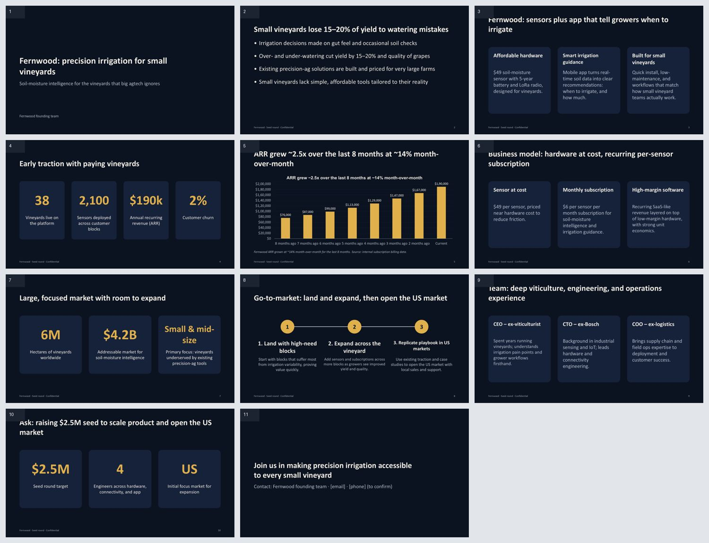
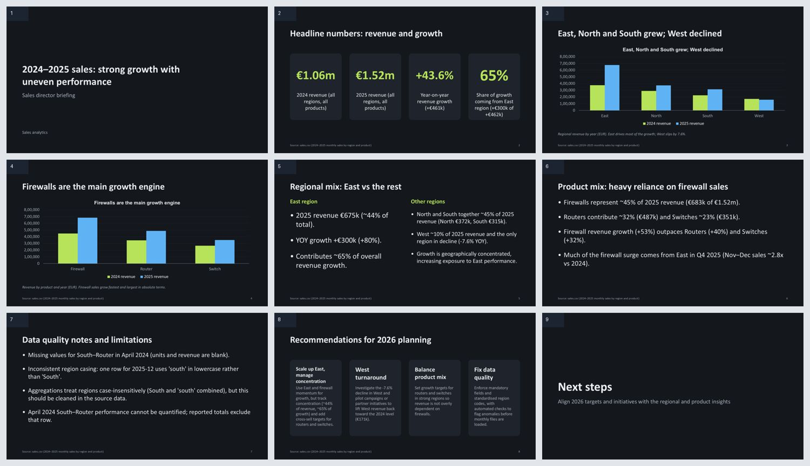
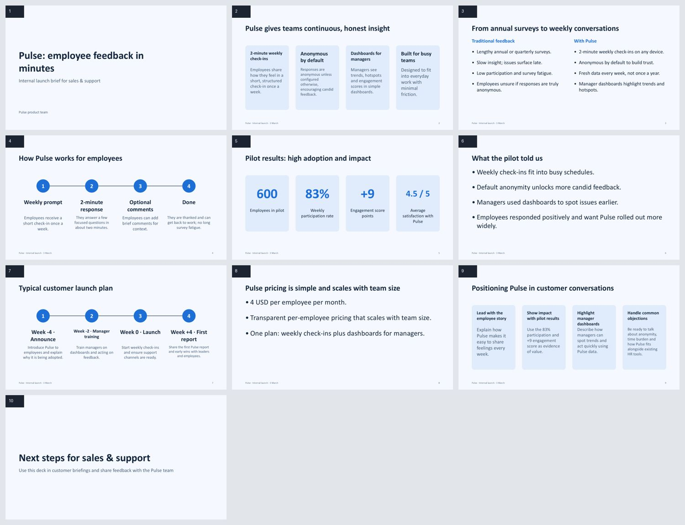
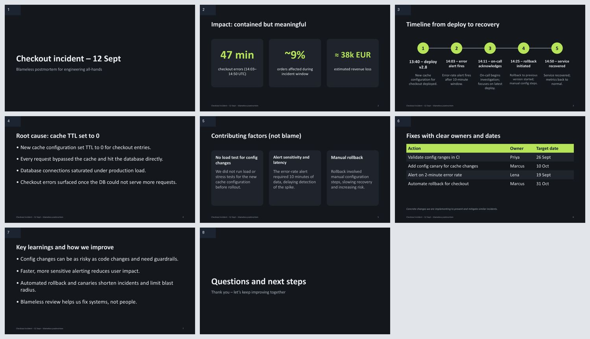
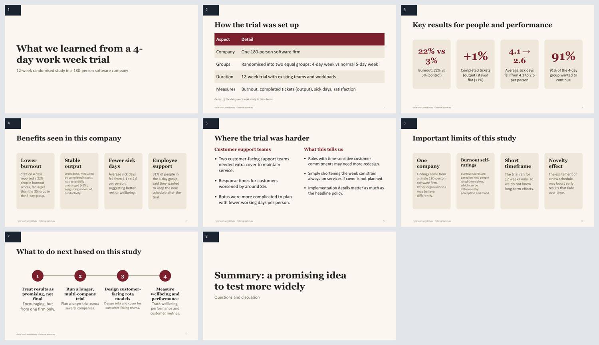
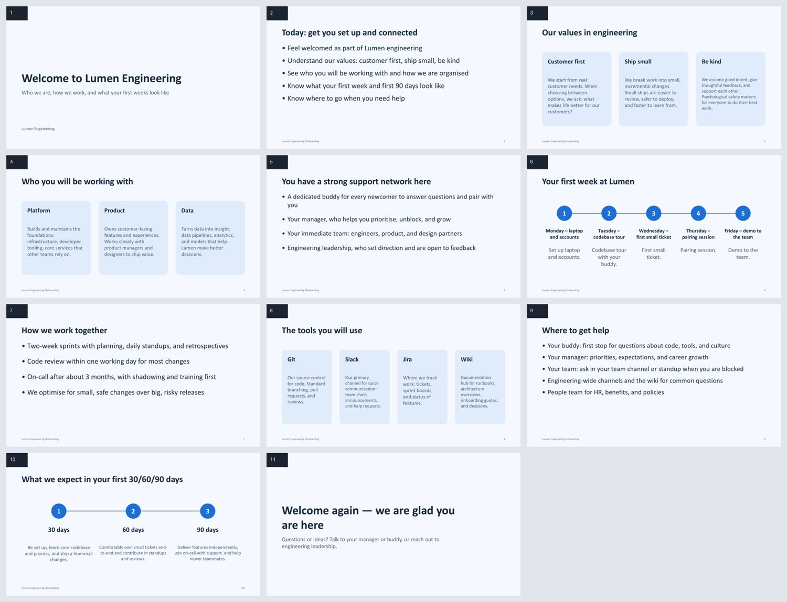

# Examples gallery

Decks DebCraft made from the request shown, as rendered by PowerPoint (benchmark run `baseline-3`; made by `scripts/dev/make_deck_gallery.py`).
Each picture is a contact sheet of the slides. The scores are the benchmark judge's (1 to 5, generous: 4 is a competent deck).

## Investor pitch

**The request**

> Make a pitch deck for a seed round for "Fernwood", a startup that sells soil-moisture sensors and a mobile app to small vineyards.
> Facts: 3 founders (CEO ex-viticulturist, CTO ex-Bosch, COO ex-logistics). Problem: vineyards lose 15-20% of yield to over or under watering. Product: a 49 USD sensor, 5-year battery, LoRa radio, app tells you when and how much to irrigate. Traction: 38 vineyards, 2,100 sensors deployed, 190k USD annual recurring revenue, growing 14% month over month for the last 8 months, churn 2%. Market: 6 million hectares of vineyards worldwide, 4.2 billion USD addressable. Business model: sensor at cost plus 6 USD per sensor per month subscription. Raising 2.5 million USD to hire 4 engineers and open the US market. Make it persuasive, with at least one chart of the growth.

Slides: 11; judge average: 4.3

## Data story

**The request**

> The file project/sales.csv has monthly sales by region and product for 2024 and 2025. Analyse it and make a data-story deck for the sales director: what changed, where, and what to do. Use real numbers from the file (compute them, do not guess), native charts, and one slide of recommendations. Mention any data quality issue you find.

Slides: 9; judge average: 5.0

## Product launch

**The request**

> Make an internal launch deck for "Pulse", our new employee-feedback app, launching on 3 March. Key messages: 2-minute weekly check-ins, anonymous by default, dashboards for managers. Pilot results: 600 employees, 83% weekly participation, engagement score +9 points, 4.5 of 5 satisfaction. Launch plan: week -4 announce, week -2 manager training, week 0 launch, week +4 first report. Pricing: 4 USD per employee per month. Target audience: the sales and support teams who will present it to customers.

Slides: 10; judge average: 4.7

## Incident postmortem

**The request**

> Make a blameless postmortem deck for the engineering all-hands. Incident: on 12 Sept at 14:03 UTC the checkout service returned errors for 47 minutes (about 9% of orders affected, est. 38k EUR lost). Timeline: 13:40 deploy of v2.8 with a new cache config; 14:03 error rate alert; 14:11 on-call acknowledged; 14:25 rollback started; 14:50 recovered. Root cause: cache TTL set to 0 made every request hit the database, which saturated connections. Contributing: no load test for config changes, the alert fired late because it needed 10 minutes of data, the rollback needed manual steps. Actions: validate config ranges in CI (owner Priya, 26 Sept), add a config canary (owner Marcus, 10 Oct), alert on 2-minute error rate (owner Lena, 19 Sept), automate rollback (owner Marcus, 31 Oct).

Slides: 8; judge average: 4.7

## Research summary

**The request**

> Summarise this study for non-experts in a deck. Study: a 12-week randomised trial of a 4-day work week at a 180-person software firm (90 employees in each group). Results: burnout score fell 22% in the 4-day group versus 3% in the control; output measured by completed tickets was unchanged (+1%); sick days fell from 4.1 to 2.6 per person; 91% of the 4-day group wanted to continue; two teams with customer-facing support rotas had to add cover and saw response times worsen by 8%. Limitations: one company, self-reported burnout, 12 weeks only, possible novelty effect. Conclusion: promising, run a longer multi-company trial. Make it clear and honest about the limits.

Slides: 8; judge average: 4.7

## Onboarding

**The request**

> Make a first-day onboarding deck for new engineers at a 200-person company called Lumen. Cover: welcome and our values (customer first, ship small, be kind), who is who (the engineering org: platform, product, data; a buddy for every newcomer), your first week (Mon laptop and accounts, Tue codebase tour, Wed first small ticket, Thu pairing session, Fri demo to the team), how we work (two-week sprints, code review within one working day, on-call after 3 months), the tools (Git, Slack, Jira, a wiki), where to get help, and what we expect in 30/60/90 days. Friendly tone.

Slides: 11; judge average: 5.0

